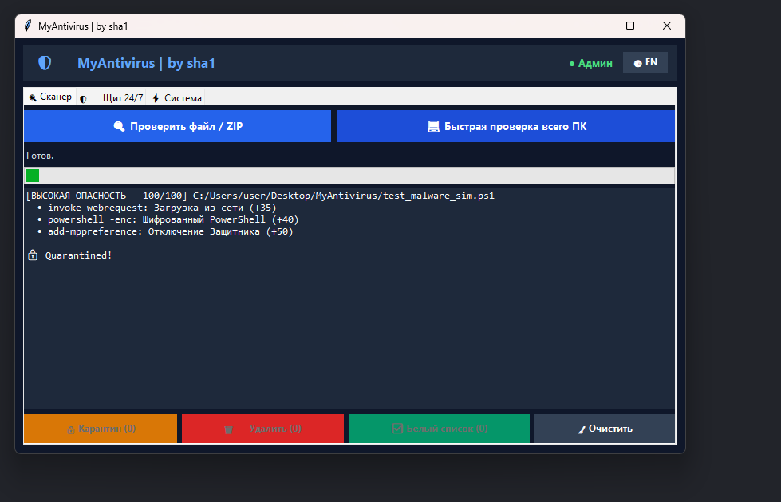

# 🛡️ MyAntivirus | by sha1



*[English](#english) | [Русский](#русский)*

---

<a name="english"></a>
## 🇬🇧 English

Lightweight heuristic and signature-based antivirus for Windows written in Python. Built from scratch to explore how real AV engines inspect PE files, verify signatures, and monitor the system without heavy bloatware.

### Features
* **Signature Verification (`WinVerifyTrust`):** checks if `.exe` and `.dll` files are signed by trusted vendors via the native Windows API.
* **PE Heuristics & Entropy:** detects packed or obfuscated sections (entropy > 7.4), hidden overlays, and suspicious API calls (`WriteProcessMemory`, `VirtualAlloc`, `URLDownloadToFileW`).
* **Stealer, Miner & Spoof Detection:** catches Telegram/Discord webhooks, `stratum+tcp://` mining pools, Windows Defender tampering, and `MZ` executables disguised as `.jpg` or `.txt`.
* **In-Memory ZIP & Deep Re-check:** scans `.zip` contents in RAM without extracting to disk, checks hidden folders, and runs a second verification pass to reduce false positives.
* **24/7 Shield & System Monitor:** watches `Downloads` and `Desktop` in real time, audits `Run` registry keys, running processes, and active TCP connections.
* **Quarantine & Whitelist:** isolates threats into `_Quarantine`, deletes them permanently, or saves safe paths to `signatures.json`.

### Quick Start
```bash
pip install pefile
python gui_antivirus.py
```
*Run as Administrator for full access to hidden system directories.*

---

<a name="русский"></a>
## 🇷🇺 Русский

Лёгкий эвристический и сигнатурный антивирус для Windows на Python. Написан с нуля, чтобы разобраться, как настоящие антивирусы проверяют `.exe`-файлы, цифровые подписи и процессы без гигабайтов лишнего софта.

### Что умеет
* **Проверка подписей (`WinVerifyTrust`):** проверяет сертификаты `.exe` и `.dll` через нативный Windows API.
* **Эвристика и энтропия PE:** находит сжатые или обфусцированные секции (энтропия > 7.4), скрытые данные в конце файла и опасные API-вызовы (`WriteProcessMemory`, `VirtualAlloc`, `URLDownloadToFileW`).
* **Поиск стиллеров, майнеров и подмен:** обнаруживает вебхуки Telegram/Discord, майнинг-пулы (`stratum+tcp://`), попытки отключить Защитник Windows и исполняемые файлы (`MZ`), замаскированные под `.jpg` или `.txt`.
* **Проверка `.zip` в памяти и перепроверка:** сканирует архивы в ОЗУ без распаковки на диск, проверяет скрытые папки и проводит второй этап анализа для отсеивания ложных срабатываний.
* **Щит 24/7 и монитор системы:** отслеживает папки «Загрузки» и «Рабочий стол» в реальном времени, проверяет автозагрузку в реестре, активные процессы и внешние TCP-соединения.
* **Карантин и белый список:** изолирует угрозы в папку `_Quarantine`, удаляет их навсегда или добавляет безопасные пути в исключения (`signatures.json`).

### Запуск
```bash
pip install pefile
python gui_antivirus.py
```
*Для доступа ко всем скрытым системным папкам рекомендуется запуск от имени администратора.*
